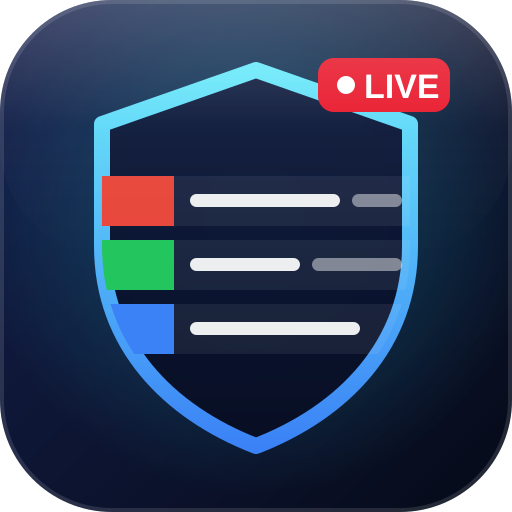

  

<h1 align="center">TickerSec</h1>

<b>Breaking news and cybersecurity alerts right on your Windows desktop — live, scrolling, and impossible to miss.</b>

  
  
  
  
  

## What it does

| Area | Items |
|---|---|
| 📰 **News agencies** | 180+ built-in sources in 14 groups — world news by region (BBC, NPR, NYT, Fox, Al Jazeera, DW, Le Monde, NHK…) plus Cybersecurity, Government Cyber Alerts (CISA, FBI & IC3, UK NCSC, Canada, Australia), Technology, Science & Space, Health, Business & Markets, Sports, Weather & Disasters and Gaming — and any RSS or Atom feed you add |
| 📺 **Tickers** | One scrolling bar per agency, stacked at the top or bottom of the screen; topic categories get a title strip and collapse into one combined bar |
| 🔔 **Alerts** | Keyword alerts, BREAKING detection, a one-time glow for new alert headlines, Windows notifications and an optional chime (5 sounds) with quiet hours |
| 🌐 **Translation** | Headlines from other languages translated into yours, with the original shown on hover |
| ⚙️ **Settings page** | A Status page with the health of every feed, quick actions and a live preview; pick agencies, drag to reorder, rename and recolor bars, tune size, speed, opacity and refresh timing |

## Features

- **CISA KEV** — actively exploited vulnerabilities straight from CISA's catalog
- **Power & telecom news** — two consolidated tickers: power outage news (news, ERCOT/CenterPoint and major utilities) and internet & phone outage news (Xfinity, Spectrum, AT&T, Verizon, T-Mobile, Starlink, 911), plus local restoration news, outage counts and Downdetector user-report news
- **Security operations** — Service Outages (one consolidated ticker from AWS, Azure, Microsoft 365, Google Cloud, Cloudflare, GitHub and more), Vendor Security Advisories, Threat Intelligence and Data Breaches
- **Cyber Breaking News** — one ticker, consolidated feed, for zero-days, breaches, ransomware and CISA/FBI warnings from Google News, top security outlets and government feeds, newest first
- **Breaking Across the U.S.** — one ticker, consolidated feed, watching Google News and 36 local TV stations nationwide for explosions, fires, evacuations, hazmat and disasters, newest first, each headline tagged with its station
- **Window mode** — show the tickers in a normal window you can move, resize and minimize; docked tickers scroll when there are more than fit
- **On/Off switch** — turn TickerSec off (no tickers, headlines or alerts) and back on from Settings, the tray, or Ctrl + Alt + T; remembered after a restart
- **Status page** — Settings opens on a live overview: feeds working, headline count, last refresh and memory, every feed with a green / amber (backup) / red dot and the reason it failed, plus quick actions (refresh, hide, refresh the tickers, open the log, click report)
- **Live preview** — the Display and Alerts pages show sample tickers that change as you move the sliders
- **Automatic updates** — every install checks this repository's latest GitHub release; when a newer version is out, a small panel slides up once and installs it in one click (also from the tray and Settings), with the download verified against its checksum
- **Stays responsive** — the ticker window quietly rebuilds itself every few hours and after sleep, and old data is trimmed, so a TickerSec left running for days stays quick
- **Collapsible categories** — Cybersecurity, Technology and other topic groups get a slim title strip; click it to combine the group into one bar (each headline tagged with its source), click the bar's label to expand again — also in the tray menu
- **Select all / Deselect all** — turn a whole region or category on or off in one click
- **Seamless scrolling** — smooth, continuous ticker loop; new headlines are swapped in at the end of a pass so nothing jumps
- **NEW tags** — fresh headlines get a red **NEW** tag, and each one shows its age (e.g. 12m)
- **Keyword alerts** — list words or phrases ("Steelers", "Oak Creek", "hurrican*"); matching headlines are highlighted in gold and can raise an alert pop-up even while the tickers are hidden
- **Breaking detection** — headlines starting with BREAKING, LIVE, WATCH LIVE, URGENT, JUST IN or DEVELOPING turn red and jump to the front of their bar
- **Alert pop-ups** — a glass pop-up slides in at the bottom-right (always shows), or use Windows notifications, or both
- **Preview buttons** — see exactly what a NEW, keyword or breaking headline, the glow, each pop-up and the chime look and sound like
- **glow (0–10 passes)** — a brand-new alert headline pulses the first time it scrolls by
- **Soft chime** — optional sound for new alerts, with quiet hours for the night
- **Cybersecurity sources** — CISA advisories, Krebs on Security, The Hacker News, BleepingComputer, Dark Reading, SecurityWeek, The Record, SANS ISC and more
- **Test all agencies** — one click checks every source and outlines it green or red
- **Only NEW filter** — scroll just the fresh headlines (switch it on in Settings or straight from the tray menu)
- **Click to read** — click any headline to open the full story in your browser; hover pauses the bar
- **On top or behind** — by default the files and programs you open come in front of the tickers; switch on "Keep tickers on top" to keep them above everything
- **Click-through mode** — make the bars ignore the mouse so you can work underneath them
- **Four translation services** — Google (free, no key), MyMemory (free), LibreTranslate (self-hosted or hosted) and DeepL (API key)
- **Browser fallback** — if a site answers with a block or bot-check page, the feed is read through a hidden built-in browser instead
- **Feed tester** — check any feed address before adding it, and see a live status dot for every agency
- **Multi-monitor** — choose which screen the tickers sit on
- **Tray app** — hide/show, pause, refresh now and Settings from the tray icon; **Ctrl + Alt + N** hides or shows the tickers
- **Start with Windows** option

## Install

1. Download **TickerSec-Setup.exe** from the [latest release](https://github.com/Degederon/TickerSec/releases/latest).
2. Run it. It's one click: no questions. If an older version is installed or running, Setup closes it, uninstalls it and installs the new one — your settings and agencies are kept.
3. On a new install, a short welcome greets you, explains what TickerSec does, and lets you pick up to 4 categories (U.S. News, World News, Cybersecurity, Government Cyber Alerts, Technology, Science & Space, Health, Business & Markets, Sports, Weather & Disasters, Gaming) and whether the tickers sit at the top or bottom. TickerSec is then set up with exactly that. Fine-tune any time in Settings. Upgrading keeps your current setup — no questions.

> Windows SmartScreen may say "Windows protected your PC" because the installer isn't code-signed — click **More info → Run anyway**.

### Publishing an update

1. Raise `version` in `package.json` and run `npm run dist`.
2. Create a GitHub release tagged `v<version>` and attach **TickerSec-Setup.exe** and **latest.json** from `dist/release`.
3. Every TickerSec install sees the new version within a few hours, or right away with **Check for updates**.

### Uninstall

Windows Settings → Apps → TickerSec → Uninstall. TickerSec asks once whether to keep your settings: **Yes** keeps your news services, alerts and other settings for a future reinstall; **No** removes everything — settings, saved sign-ins, caches and leftover update downloads — as if it was never installed; **Cancel** keeps it installed.

### Build the installer from source

Install [Node.js](https://nodejs.org) (LTS), then in the project folder run `npm install` and `npm run dist`. The installer is written to the `dist` folder.

### Open Settings any time

Right-click a ticker, click the tray icon, or start the app again.

## Privacy

TickerSec talks only to the feed addresses you choose, to GitHub to check for updates and, if translation is turned on, to the translation service you pick (headlines only). Settings stay on your PC in `%APPDATA%\TickerSec\settings.json`. No accounts, no tracking.

## Formerly Breaking News

TickerSec was called **Breaking News** up to version 1.6.1. Installed copies upgrade to TickerSec automatically and keep their settings.

## License

[MIT](LICENSE) © 2026 Degederon · [EPOMD Training Labs, EZ Tools and More](https://www.youtube.com/@epomd)
